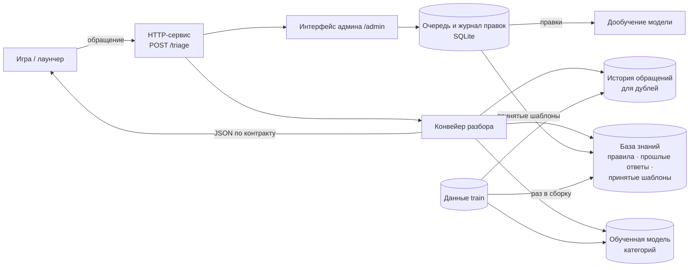

# Как устроено решение

Концептуально, без разбора кода. Где лежит конкретный файл — в таблице «Карта модулей» внизу.

## Общая картина

Если схема не отрисовалась: игра присылает обращение → сервис разбирает его, опираясь на базу знаний, модель и историю → возвращает JSON. Параллельно обращения попадают в очередь интерфейса админа; решения админа сохраняются и возвращаются в систему (дообучение, новые шаблоны).

## Путь одного обращения

| Шаг | Что происходит | Зачем |
|---|---|---|
| 1. Очистка | Убираем мусор, восстанавливаем казахские буквы из «игровой» кодировки (`ќ` → `қ`), не путая их с украинскими. Ответы админов во входе игнорируем | Чтобы дальше работать с нормальным текстом |
| 2. Язык | По частым словам и буквам: ru, kk, uz, en, es, pt | На этом языке будет черновик |
| 3. Факты | Ник обвиняемого, названные пункты («2.1оп» → 2.1, «1.1 gz» → GZ 1.1), скриншоты или видео, номер сервера | Это пойдёт в `extracted` и в решение |
| 4. Категория | Сначала правила (словари признаков), потом обученная модель может поправить, если уверена | Правила надёжны на частых случаях, модель ловит то, что правила пропускают (например, апелляции) |
| 5. Срочность | По таблице заказчика + доказательства и угрозы | p0 сверху очереди |
| 6. Дубль? | Тот же игрок, та же цель, первое ещё без ответа, похожий текст | Склеить «5 одинаковых жалоб за час» |
| 7. Поиск (RAG) | Пункты правил (гибридный поиск + подсказка категории), похожие прошлые ответы админов, термины из глоссария правил | Ответ опирается на найденное, а не на фантазию |
| 8. Черновик | Принятый админом шаблон для таких обращений → иначе языковая модель (если есть ключ) → иначе шаблон по ситуации | Всегда есть готовый текст |
| 9. Проверки | Каждый номер пункта существует и найден поиском, нет обещаний разбана и возврата, язык совпадает, нет чужих ников | Ноль галлюцинаций |
| 10. Нужен ли человек | Платёж, взлом, апелляция, наказание, угрозы, низкая уверенность → да | Сервис не решает за админа |

## База знаний (что именно ищет RAG)

1. **Правила игры** — 266 пунктов. Номера повторяются в разных разделах, поэтому у раздела есть метка: общие правила без метки (`2.1`), правила подачи жалоб — `ЖБ 1.2.7`, Зелёная зона — `GZ 1.1`, семейные мероприятия — `FW 1.6` и так далее. К пунктам добавлены слова игроков («софт, чит, аим» у 5.2), а сленг в запросе расшифровывается («дм» → «убийство без RP-причины»).
2. **Прошлые ответы админов** — 32 тыс. обращений из train с содержательными ответами (без «слежу за вами»), для kk и uz — на том же языке. Админ видит их в карточке, языковая модель получает их как образцы стиля.
3. **Принятые шаблоны** — ответы, которые админ одобрил для группы похожих обращений. Только их сервис отправляет как готовый ответ.

Качество поиска по правилам на valid: пункт, который назвал админ, в первых пяти найденных — 91,7% (первая версия поиска — 67%).

## Решения, которые мы приняли сознательно

- **Правила + модель, а не только модель.** Модель учили на разметке из ответов админов, а в ней перекосы: например, DM-жалоба получает метку, только если её одобрили. Поэтому там, где правила точнее (читы, DM, мошенничество, «не жалоба»), модель переубеждает их только при уверенности от 0,8.
- **Шаблоны как основа, языковая модель как улучшение.** Без ключа и интернета сервис работает полностью; с ключом тексты живее, но любая проблема — откат к шаблону.
- **Каждая функция включается флагом и умеет откатываться.** Нет файла модели — работают правила; нет истории — нет дублей; нет ключа — шаблоны.

## Технологии и стек

| Что | Чем | Почему |
|---|---|---|
| Язык | Python 3.12+ | Быстро писать, всё нужное для ML есть |
| HTTP-сервис | FastAPI + Uvicorn | Простой, сам проверяет формат запросов и ответов |
| Формат данных | Pydantic | Контракт `/triage` описан как модели — ошибку формата видно сразу |
| Классификатор | scikit-learn: TF-IDF по фрагментам слов + логистическая регрессия | Работает на CPU за миллисекунды, не боится опечаток, легко переобучить |
| Поиск (RAG) | scikit-learn: TF-IDF по фрагментам слов и по словам | Без внешних сервисов и скачивания моделей, работает офлайн |
| Группы похожих обращений | scikit-learn: MiniBatchKMeans | Быстро на 118 тыс. текстов |
| Языковая модель (опционально) | Claude Haiku 5.5 через Anthropic SDK, JSON-схема ответа | Дёшево (~$0,0003 за обращение), быстро; поле `cited` разрешает только найденные пункты |
| Очередь и журнал правок | SQLite | Один файл, не нужен сервер базы данных |
| Интерфейс админа | Один HTML-файл, чистый JavaScript, шрифт Golos Text | Не нужна сборка, открывается из того же сервиса |
| Тесты | pytest | 61 тест: контракт, безопасность, RAG, дубли, интерфейс |
| Запуск | Makefile, Docker | Одна команда на каждое действие; данные монтируются, в образ не попадают |

## Что хранится и где

| Что | Где | Откуда берётся | В git? |
|---|---|---|---|
| Код | `copilot/`, `scripts/`, `tests/` | пишем мы | да |
| Данные кейса | `../grand-support-copilot-handout-2026-10-27/handout` | организаторы | **нет**, нельзя |
| Модель, индексы, история, группы | `artifacts/` | `make artifacts` из train | нет (содержит тексты из данных) |
| Очередь админа, отчёты, прогоны | `out/` | сервис и скрипты | нет |
| Ключ к языковой модели | `.env` | вы | нет |

## Карта модулей

| Модуль | Роль |
|---|---|
| `copilot/normalize.py` | Очистка текста, казахские буквы |
| `copilot/langid.py` | Язык |
| `copilot/rules.py` | Пункты правил, метки разделов, разбор ссылок «2.1оп» |
| `copilot/extract.py` | Факты из текста |
| `copilot/classify.py` | Категория, срочность, ситуация черновика (правила) и смешивание с моделью |
| `copilot/ml.py` | Обученная модель категорий |
| `copilot/retrieval.py` | Поиск по правилам и по прошлым ответам |
| `copilot/rag.py` | Обязательный шаг RAG: собирает основание ответа |
| `copilot/templates.py` | Шаблоны черновиков на 6 языках |
| `copilot/llm.py`, `copilot/drafting.py` | Языковая модель и проверка её текста |
| `copilot/policy.py` | Проверка ссылок и обещаний, «нужен ли человек» |
| `copilot/dedup.py` | Дубли |
| `copilot/template_library.py` | Принятые шаблоны |
| `copilot/pipeline.py` | Собирает шаги в один проход |
| `copilot/api.py` | HTTP-сервис |
| `copilot/admin_api.py`, `copilot/admin_store.py`, `copilot/static/admin.html` | Интерфейс админа |
| `copilot/weak_labels.py` | Разметка из ответов админов (только для обучения и оценки) |
| `scripts/` | Сборка индексов, обучение, оценка, прогон истории, поиск шаблонов, загрузка демо-очереди |

## Настройки (переменные окружения)

| Переменная | По умолчанию | Что делает |
|---|---|---|
| `COPILOT_DATA_DIR` | папка handout рядом с проектом | где лежат данные |
| `COPILOT_LLM` | `auto` | `auto` — модель, если есть ключ; `0` — только шаблоны |
| `COPILOT_LLM_MODEL` | `claude-haiku-5-5` | какая модель пишет черновики |
| `COPILOT_ML` | `auto` | `0` — только правила |
| `COPILOT_DEDUP` | `auto` | `0` — без поиска дублей |
| `COPILOT_NEED_VIDEO` | `1` | `0` — DM, читы, мошенничество без видео снова получают черновик с наказанием |
| `COPILOT_RAG_CHOOSE` | `1` | пункт в черновике с наказанием выбирает поиск |
| `COPILOT_RAG_EXAMPLES` | `1` | искать похожие прошлые ответы (для массовых прогонов можно выключить) |
